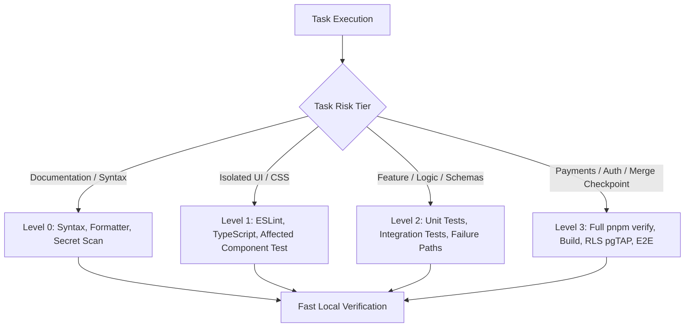

# 40. Testing Strategy & Quality Gates

**Authority:** Blueprint Part 11; SRS Section 12, NFR-MNT-01; ADR 0006, ADR 0010  
**Scope:** Applies to all automated tests, assertions, CI execution, and task verification.

---

## 1. Four-Tier Risk-Based Testing Protocol (ADR 0010)

To prevent excessive overhead on routine iterations while maintaining uncompromising production quality, verification must strictly match the task risk tier:

| Tier | Category | Required Verifications | What Is Explicitly Prohibited |
| :--- | :--- | :--- | :--- |
| **Level 0** | Documentation, Markdown, non-code configurations (`.prettierrc`, `.gitignore`). | 1. Targeted file review. 2. Configuration syntax check. 3. Secret scan (`gitleaks`). | **NO** `next build`. **NO** Vitest suite. **NO** Playwright E2E. |
| **Level 1** | Pure UI components, layout styling, static JSON content edits. | 1. `pnpm lint` on modified files. 2. `pnpm typecheck` (`tsc --noEmit`). 3. Affected component test (`vitest run <file>`). | **NO** `next build`. **NO** full integration suite. |
| **Level 2** | Feature logic, Server Actions, Zod schemas, API route handlers, CSV exports. | 1. Relevant unit & integration tests. 2. Failure-path / edge-case tests. 3. `pnpm typecheck` & `pnpm lint`. | **NO** production build during routine intermediate iterations. |
| **Level 3** | bKash payments, authentication, RLS SQL migrations, branch completion before PR merge. | 1. Complete `pnpm verify` (`tsc`, `eslint`, `prettier`, `vitest`, `next build`). 2. pgTAP RLS tests. 3. Security review workflow. | **Never skip or loosen an assertion.** |

---

## 2. Testing Pyramid & Core Verifications
1. **Static Checks:** TypeScript strict typechecking (`tsc --noEmit`), ESLint 9 with `jsx-a11y` accessibility rules, Prettier formatting checks, and Gitleaks secret scans.
2. **Unit Tests (Vitest):** Core pure business logic:
   - Pricing functions, discount rules, fee calculation, integer poisha conversions (`poishaToBdtString`, `bdtStringToPoisha`).
   - Reference generation (Crockford Base32 format and uniqueness).
   - Zod validation schemas with valid and invalid fixtures.
3. **Component Tests (Vitest + Testing Library):**
   - Form state transitions (default, submitting, validation error, success, failure).
   - Accessible disclosures, dialogs, and keyboard navigation.
4. **Database & Policy Tests (pgTAP):**
   - RLS isolation: prove `anon` cannot read unpublished data or write operational records.
   - Concurrency tests: verify row-locking prevents seat overselling under parallel calls.
5. **End-to-End Tests (Playwright):**
   - Validate full acceptance test journeys across mobile (`320px`), tablet (`768px`), and desktop (`1280px`).
   - Automated `@axe-core/playwright` accessibility audits on all public pages.

---

## 3. Operational Rules & Diagnostics
- **Context Loading:** Read `AGENTS.md` and `docs/STATE.md` once per session. Do not re-scan the entire directory tree repeatedly.
- **Prohibition on PDF Extraction:** Never invoke scripts to extract raw PDF binaries (`docs/source/*.pdf`). Plain-text markdown is the textual authority.
- **Two-Attempt Limit:** When a command or test fails, diagnose the underlying cause before retrying. If it fails a second time, stop immediately and report the blocker.
- **Never Loosen Assertions:** Never weaken, skip, or delete tests to get CI green.
