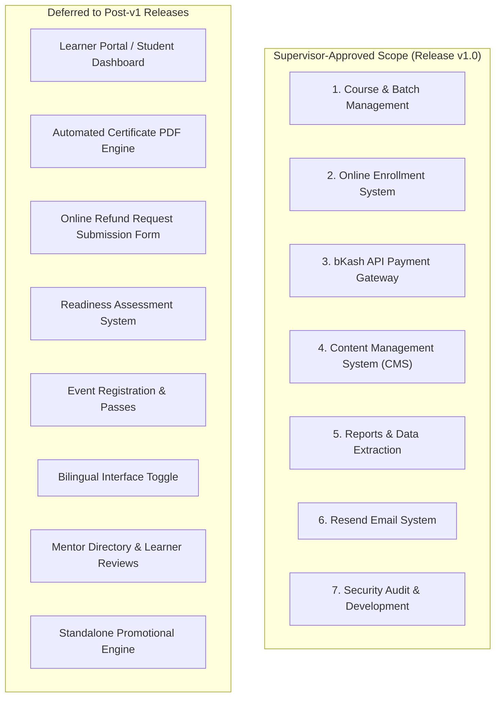

# LNA Website Scope Revision Addendum (Release v1.0)

**Document Version:** 1.0  
**Effective Date:** 4 November 2026  
**Status:** Approved by Project Owner & Supervisor  
**Authority Hierarchy:** This document serves as the formal Scope Addendum for Initial Release v1.0. It supersedes conflicting provisions of the original Software Requirements Specification (SRS) and Development Blueprint for the initial production release. The original source documents ([`docs/source/LNA_Website_SRS.pdf`](file:///d:/.internship/LNA/Website%20Development/docs/source/LNA_Website_SRS.pdf), [`docs/source/LNA Website Development Blueprint.pdf`](file:///d:/.internship/LNA/Website%20Development/docs/source/LNA%20Website%20Development%20Blueprint.pdf), and [`docs/SRS.md`](file:///d:/.internship/LNA/Website%20Development/docs/SRS.md)) remain preserved unchanged as historical references.

---

## 1. Executive Summary & Approved Business Scope

The rebuild of `lnabd.org` is strictly focused on seven supervisor-approved business modules. All development and testing efforts are aligned exclusively with these modules and the essential supporting infrastructure required to operate them securely, reliably, and accessibly.



---

## 2. The Seven Approved Business Modules

### Module 1: Course and Batch Management System
* **Course Lifecycle:** Create, update, publish, and archive offline courses with structured syllabi, outcomes, FAQs, and refund terms.
* **Batch Operations:** Manage dated batches, schedules, venues, seating capacity, list fees, and enrollment opening/closing dates.
* **Public Catalogue:** Display open and upcoming batches publicly with transparent fee and schedule disclosures.
* **Staff Control:** Authorized administrators manage all course and batch data through dedicated forms in the Admin Portal.

### Module 2: Online Enrollment System (Application & Status)
* **Universal Application Form:** Public course enrollment collecting applicant details without resume or file uploads. Protected by Cloudflare Turnstile and rate limiting.
* **Unguessable Reference:** Generation of Crockford Base32 application references (e.g. `LNA-7K3M-9XQ2`).
* **Duplicate Prevention:** Atomic reconciliation preventing duplicate confirmed seats for the same email and batch.
* **Seat Capacity & Holds:** PostgreSQL row-locked reservation (`SELECT FOR UPDATE`) reserving a 30-minute hold (`hold_expires_at = now() + interval '30 minutes'`).
* **Public Status Lookup (`FR-ENR-004`):** Rate-limited public portal allowing applicants to check their status using `public_ref` + `email` without requiring an authenticated learner dashboard account.
* **Payment Linkage:** Seamless transition from seat reservation to bKash checkout.

### Module 3: Payment Integration through bKash API
* **Target Architecture:** Direct bKash Payment Gateway API integration (URL-Based Checkout / Tokenized Checkout in mode `0011` agreement-less).
* **Payment Invariants:** Server-only credentials (`BKASH_*`), pure integer poisha financial arithmetic (zero floats, zero `.toFixed()`), and mandatory server-to-server validation.
* **Safe Expiration & Retries:** Untrusted browser redirects with `cancel` or `failure` never prematurely release seat holds. Holds expire passively in SQL queries; applicants can retry checkout within their 30-minute reservation window.
* **Delayed Verification & Reconciliation:** Asynchronous reconciliation cron re-queries pending transactions against bKash search/query APIs to recover from network drops.
* **Receipt Generation:** Tamper-evident PDF receipts delivered via Resend email and downloadable via short-lived HMAC-SHA256 signed URLs.

### Module 4: Content Management System (CMS)
* **Homepage Administration:** Manage hero slides/banners, announcements, informational sections, and section visibility toggles.
* **Course Content Management:** Rich administrative editors for course descriptions, outlines, and refund policy parameters.
* **Image Management Pipeline:** Secure image upload validating MIME magic bytes, dimensions, and mandatory accessible alternative text.
* **Dual-Layer Architecture:** Swappable `@/lib/content` abstraction supporting static JSON seed files in early development and Supabase PostgreSQL in production.
* **Proven Institutional Credibility:** Enforcement of provenance blocks (Class A Verified vs. Class B Demo) preventing unverified claims from reaching production.

### Module 5: Reports and Data Extraction Features
* **Operational Reporting:** Tabular views for course capacity, batch enrollments, applicant statuses, and revenue collections.
* **Authorized CSV Exports:** Role-protected CSV download utilities with column filtering for staff accounting and operations.
* **Export Auditing:** Tamper-evident logging capturing actor ID, timestamp, filters, and row counts in `audit_events`.

### Module 6: Transactional Email System
* **Provider:** Managed transactional delivery via Resend API.
* **Asynchronous Outbox:** Non-blocking email processing using the `email_outbox` table (`status`, `retry_count`, `provider_message_id`, `error_log`).
* **Branded Templates:** High-contrast HTML/text templates for Application Confirmation, bKash Payment Receipt, and Staff Security / 2FA Alerts.
* **Failure Handling & Retries:** Automatic retries for transient API failures with exponential backoff.
* **Scope Boundary:** Resend is used strictly for transactional website emails. Employee mailbox hosting is outside project scope; no custom webmail client will be developed.

### Module 7: Security Audit and Development
* **Staff Authentication:** Email and password authentication exclusively for staff; zero public learner user registration in Supabase Auth.
* **Mandatory Staff 2FA:** Authenticator app (TOTP) or short-lived, single-use cryptographically hashed email verification codes.
* **Authorization & RLS:** Server-side access guards (`requireStaff()`, `requireOwnership()`) backed by PostgreSQL Row Level Security.
* **Abuse Protection:** Distributed rate limiting via Upstash Redis and bot protection via Cloudflare Turnstile.
* **Environment Isolation:** Zero service keys or secrets exposed to client bundles; `@/server` modules guarded by `server-only`.
* **Testing & Quality Gates:** Risk-based testing hierarchy (Levels 0–3) ensuring production verification without unnecessary routine overhead.

---

## 3. Requirement Baseline Classification (All 129 Items)

The requirement baseline is mapped with complete auditability: **67 RETAIN, 24 MODIFY, and 38 DEFER (Total: 129)**.

```
┌────────────────────────────────────────────────────────────────────────┐
│                        REQUIREMENT BASELINE MATRIX                    │
├───────────────────┬──────────────┬──────────────┬──────────────┬───────┤
│ Requirement Type  │    RETAIN    │    MODIFY    │    DEFER     │ TOTAL │
├───────────────────┼──────────────┼──────────────┼──────────────┼───────┤
│ Functional (FR)   │      38      │      14      │      25      │   77  │
│ Non-Functional    │      15      │       0      │       0      │   15  │
│ Business Rules    │       9      │       3      │       6      │   18  │
│ Use Cases (UC)    │       0      │       2      │       2      │    4  │
│ Acceptance Tests  │       5      │       5      │       5      │   15  │
├───────────────────┼──────────────┼──────────────┼──────────────┼───────┤
│ TOTALS            │      67      │      24      │      38      │  129  │
└───────────────────┴──────────────┴──────────────┴──────────────┴───────┘
```

### 3.1 Functional Requirements (77 Items)

| ID | Summary | Classification | Module & Action for Release v1.0 |
| :--- | :--- | :--- | :--- |
| `FR-PUB-001` | Primary navigation | **MODIFY** | Retain Home, About, Courses, Contact, Admin Login. Omit Events and Learner Portal. |
| `FR-PUB-002` | Homepage sections order | **MODIFY** | Retain Hero, Batches, About/Impact, Contact. Omit Events and Assessment sections. |
| `FR-PUB-003` | Admin hero slides config | **RETAIN** | Staff manages slides and banners in Admin CMS. |
| `FR-PUB-004` | Accessible hero slider | **RETAIN** | WCAG 2.2 AA compliant carousel controls. |
| `FR-PUB-005` | About section impact figures | **RETAIN** | Restricted to verified Class A figures. |
| `FR-PUB-006` | Learner reviews carousel | **DEFER** | Review curation and carousel deferred. |
| `FR-PUB-007` | Public policy pages | **RETAIN** | Privacy Policy, Terms, and Refund Policy pages. |
| `FR-CMS-001` | Administrative CMS forms | **MODIFY** | Retain for courses, batches, and homepage; defer events and reviews. |
| `FR-CMS-002` | Content editorial workflow | **RETAIN** | Draft, preview, publish, archive content autonomously. |
| `FR-CMS-003` | Referenced record integrity | **RETAIN** | Hard deletes banned; archive-only rule enforced. |
| `FR-CMS-004` | Content audit logging | **RETAIN** | Creator, last editor, and timestamps captured in `audit_events`. |
| `FR-CMS-005` | Secure image upload pipeline | **RETAIN** | Validation of MIME magic bytes, dimensions, and alt text. |
| `FR-CRS-001` | Course creation interface | **RETAIN** | Syllabus, eligibility, outcomes, FAQs, refund terms. |
| `FR-CRS-002` | Batch scheduling interface | **RETAIN** | Dates, capacity, venue, pricing, deadlines. |
| `FR-CRS-003` | Course catalogue grouping | **RETAIN** | Open, Upcoming, Closed grouping. |
| `FR-CRS-004` | Homepage open batches | **RETAIN** | Open batches display with upcoming fallback. |
| `FR-CRS-005` | Course details page | **RETAIN** | Logistics, available capacity, and upfront fees. |
| `FR-CRS-006` | Seat reservation engine | **RETAIN** | Row-locked 30-min holds preventing overselling. |
| `FR-CRS-007` | Historical batch archiving | **RETAIN** | Archive-only batch records preserving pricing/enrollments. |
| `FR-ENR-001` | Universal application form | **RETAIN** | Standard intake form without file uploads. |
| `FR-ENR-002` | Submission processing | **RETAIN** | Unique Crockford Base32 reference issuance. |
| `FR-ENR-003` | Duplicate application check | **RETAIN** | Prevents duplicate seats for same email and batch. |
| `FR-ENR-004` | Public status lookup | **RETAIN** | Rate-limited status check via `public_ref` + `email`. |
| `FR-ENR-005` | Direct free batch confirmation | **MODIFY** | Instant seat confirmation + email; no student password creation. |
| `FR-ENR-006` | Confirmed enrollment linking | **MODIFY** | Links record and issues confirmation email; no student portal login. |
| `FR-PAY-001` | Configurable discounts | **MODIFY** | Simplified to batch fee overrides; standalone campaign engine deferred. |
| `FR-PAY-002` | Discount fee evaluation | **MODIFY** | Simplified server-side fee resolution without negative balances. |
| `FR-PAY-003` | Server-side fee snapshot | **RETAIN** | Snapshotting of base fee, discount, and payable amount. |
| `FR-PAY-004` | Payment session initiation | **MODIFY** | Direct bKash Tokenized Checkout initiation (`createPayment`). |
| `FR-PAY-005` | Server-to-server validation | **MODIFY** | Direct bKash `executePayment` + `queryPayment` status checks. |
| `FR-PAY-006` | Idempotent payment callback | **RETAIN** | Prevents duplicate seats or receipts on retry. |
| `FR-PAY-007` | Payment attempt audit log | **RETAIN** | Complete ledger of initiated, failed, cancelled, and validated states. |
| `FR-PAY-008` | Risk-flagged isolation | **MODIFY** | Adapted to bKash response status and currency/amount verification. |
| `FR-PAY-009` | Receipt and email dispatch | **RETAIN** | Decoupled via `email_outbox`. |
| `FR-AUT-001` | Public signup disabled | **RETAIN** | Zero public user registration in Supabase Auth. |
| `FR-AUT-002` | Email and password auth | **MODIFY** | Restricted to staff only; no student passwords in v1. |
| `FR-AUT-003` | Disabled account restriction | **RETAIN** | Block disabled staff sessions. |
| `FR-AUT-004` | Mandatory staff 2FA | **RETAIN** | TOTP authenticator app or email verification code. |
| `FR-AUT-005` | Single-use staff email codes | **RETAIN** | Rate-limited, hashed email codes for staff login. |
| `FR-AUT-006` | Learner profile editing | **DEFER** | Student portal profile editing deferred. |
| `FR-AUT-007` | Password reset & recovery | **RETAIN** | Secure password reset and factor recovery for staff. |
| `FR-LRN-001` | Learner dashboard | **DEFER** | Student dashboard deferred. |
| `FR-LRN-002` | Detailed course logistics | **MODIFY** | Published on course details page & confirmation email. |
| `FR-LRN-003` | Self-service student portal | **DEFER** | Receipts sent via email/lookup; certs/refunds deferred. |
| `FR-LRN-004` | Announcement broadcast | **MODIFY** | Admin email broadcast to batch via Resend; no dashboard view. |
| `FR-LRN-005` | Announcement delivery logs | **RETAIN** | Delivery state tracked in `email_outbox`. |
| `FR-LRN-006` | LMS exclusion rule | **RETAIN** | Reaffirms strict exclusion of video lessons, assignments, LMS. |
| `FR-RFC-001` | Learner refund request form | **DEFER** | Public online refund request form deferred. |
| `FR-RFC-002` | Admin refund lifecycle | **MODIFY** | Retain internal admin refund recording ledger for offline bank transfers. |
| `FR-RFC-003` | Refund settlement details | **RETAIN** | Requires transfer date, amount, and reference for audit. |
| `FR-RFC-004` | Portal refund status tracking| **DEFER** | Student portal refund tracking deferred. |
| `FR-RFC-005` | Certificate completion gate | **DEFER** | Certificate module deferred. |
| `FR-RFC-006` | PDF certificate generator | **DEFER** | Certificate module deferred. |
| `FR-RFC-007` | Dynamic certificate fields | **DEFER** | Certificate module deferred. |
| `FR-RFC-008` | Certificate issuance logs | **DEFER** | Certificate module deferred. |
| `FR-EVT-001` | Admin event management | **DEFER** | Events module deferred. |
| `FR-EVT-002` | Event listing pages | **DEFER** | Events module deferred. |
| `FR-EVT-003` | Free event registration | **DEFER** | Events module deferred. |
| `FR-EVT-004` | Event pass email dispatch | **DEFER** | Events module deferred. |
| `FR-EVT-005` | Past event showcase | **DEFER** | Events module deferred. |
| `FR-MEN-001` | Mentor directory admin | **DEFER** | Dedicated directory deferred; mentors listed in syllabus text. |
| `FR-REV-001` | Learner reviews publishing | **DEFER** | Testimonials module deferred. |
| `FR-OTH-001` | 15-question assessment | **DEFER** | Assessment module deferred. |
| `FR-OTH-002` | Assessment scoring algorithm | **DEFER** | Assessment module deferred. |
| `FR-OTH-003` | Assessment 4-tier categories | **DEFER** | Assessment module deferred. |
| `FR-OTH-004` | Assessment email results | **DEFER** | Assessment module deferred. |
| `FR-OTH-005` | Assessment admission isolate| **DEFER** | Assessment module deferred. |
| `FR-OTH-006` | Public contact inquiry form | **RETAIN** | Turnstile-protected; forwards inquiry to staff email via Resend. |
| `FR-OTH-007` | Bilingual UI toggle | **DEFER** | Canonical English for initial release. |
| `FR-OTH-008` | Operational reports & CSV | **RETAIN** | Revenue, enrollment, batch reports with authorized CSV download. |
| `FR-OTH-009` | Traffic telemetry analytics | **DEFER** | Telemetry tracking deferred. Sentry retained for errors. |
| `FR-ADM-001` | Admin portal interface | **RETAIN** | Search, filter, pagination, empty states for admin CRUD. |
| `FR-ADM-002` | Server-side RBAC checks | **RETAIN** | Strict permission enforcement on all staff mutations. |
| `FR-ADM-003` | Administrative CSV exports | **RETAIN** | Operational and financial dataset exports. |
| `FR-ADM-004` | Export audit logging | **RETAIN** | Actor ID and timestamp logged for all exports. |
| `FR-ADM-005` | Contact inquiry desk UI | **DEFER** | Inquiries routed directly to staff email inbox. |
| `FR-ADM-006` | Super Admin security console | **RETAIN** | Manage staff roles, account states, and 2FA recovery. |

### 3.2 Non-Functional Requirements (15 Items — All RETAINED)

| ID | Summary | Classification | Scope Alignment |
| :--- | :--- | :--- | :--- |
| `NFR-PER-01` | Core Web Vitals (LCP <= 2.5s) | **RETAIN** | Public pages optimized for mobile performance. |
| `NFR-PER-02` | 100k monthly visits support | **RETAIN** | Vercel Edge CDN caching for static assets and public content. |
| `NFR-PER-03` | Transaction write throughput | **RETAIN** | Atomic row-locking on checkout seat reservation. |
| `NFR-AVL-01` | Third-party outage resilience | **RETAIN** | Public site resilient against email or API provider downtime. |
| `NFR-SEC-01` | Server-side authorization | **RETAIN** | Non-negotiable server checks (`requireStaff()`, `requireOwnership()`). |
| `NFR-SEC-02` | Environment isolation | **RETAIN** | Server-only secrets; zero client bundle leakage. |
| `NFR-SEC-03` | Abuse & rate limit protection | **RETAIN** | Upstash Redis rate limits + Cloudflare Turnstile challenges. |
| `NFR-SEC-04` | Secure session cookies | **RETAIN** | httpOnly, secure, sameSite cookies with immediate revocation. |
| `NFR-PRI-01` | Data minimization & consent | **RETAIN** | Minimal applicant PII collected on forms. |
| `NFR-A11Y-01` | WCAG 2.2 AA accessibility | **RETAIN** | Radix primitives, keyboard navigation, visible focus, color contrast. |
| `NFR-SEO-01` | Search engine optimization | **RETAIN** | Semantic HTML, XML sitemaps, OpenGraph metadata. |
| `NFR-CMP-01` | Cross-browser compatibility | **RETAIN** | Tested on Chrome, Safari, Edge, Firefox, 320px+ viewports. |
| `NFR-BCK-01` | Automated database backups | **RETAIN** | Daily Supabase backups and restore rehearsal runbook. |
| `NFR-OBS-01` | Observability & health checks | **RETAIN** | Sentry error monitoring with PII scrubbing and `/api/health`. |
| `NFR-MNT-01` | Engineering maintainability | **RETAIN** | Strict TypeScript, pinned dependencies, ESLint 9, automated tests. |

### 3.3 Business Rules (18 Items)

| ID | Summary | Classification | Scope Alignment |
| :--- | :--- | :--- | :--- |
| `BR-01` | Enrollment activation | **MODIFY** | Transition enrollment to `confirmed`; no student password account created. |
| `BR-02` | Gateway redirect validation | **MODIFY** | bKash redirects cannot confirm payment; requires server execute + query. |
| `BR-03` | No duplicate seats per batch | **RETAIN** | Unique index on `(batch_id, email)` for active enrollments. |
| `BR-04` | Batch discount precedence | **MODIFY** | Simplified batch discount override; no negative fees. |
| `BR-05` | 30-minute hold expiry | **RETAIN** | Passive read-time SQL evaluation (`hold_expires_at > now()`). |
| `BR-06` | Closed/full batch checkout block | **RETAIN** | Blocked under row locks in RPC `start_enrollment`. |
| `BR-07` | Pending applicants consume no auth | **RETAIN** | Zero learner auth accounts provisioned. |
| `BR-08` | Public status lookup | **RETAIN** | Status check via `public_ref` + `email` without dashboard sessions. |
| `BR-09` | Staff control restricted to Super Admin | **RETAIN** | Super Admin console only. |
| `BR-10` | Editorial publishing logged | **RETAIN** | Recorded in `audit_events`. |
| `BR-11` | Refund settlement requirements | **RETAIN** | Requires transfer date, amount, and reference in admin ledger. |
| `BR-12` | Certificate completion requirement | **DEFER** | Certificate module deferred. |
| `BR-13` | Certificate legal name sourcing | **DEFER** | Certificate module deferred. |
| `BR-14` | Event registration free | **DEFER** | Events module deferred. |
| `BR-15` | Assessment creates no user accounts | **DEFER** | Assessment module deferred. |
| `BR-16` | Testimonials require consent | **DEFER** | Testimonials module deferred. |
| `BR-17` | Bilingual UI toggle | **DEFER** | Canonical English for initial release. |
| `BR-18` | Operational records never deleted | **RETAIN** | Absolute prohibition on DELETE on operational tables. |

### 3.4 Use Cases (4 Items) & Acceptance Tests (15 Items)

* **`UC-01` (Paid Batch Enrollment via bKash):** **MODIFY** (Integrated with direct bKash API; receipt sent via Resend and status lookup).
* **`UC-02` (Event Registration):** **DEFER** (Events deferred).
* **`UC-03` (Certificate Generation):** **DEFER** (Certificates deferred).
* **`UC-04` (Admin Refund Settlement):** **MODIFY** (Admin recording of manual bank transfers; public form deferred).

| Acceptance Test | Summary | Classification | Scope Alignment |
| :--- | :--- | :--- | :--- |
| `AT-01` | Paid enrollment & bKash confirmation | **MODIFY** | bKash execute + status query validation. |
| `AT-02` | Payment failure & seat release | **MODIFY** | Safe server-controlled failure handling. |
| `AT-03` | Idempotent callback processing | **MODIFY** | bKash callback idempotency with row lock. |
| `AT-04` | Concurrency load capacity check | **RETAIN** | Parallel checkouts cannot oversell batch capacity. |
| `AT-05` | Free batch enrollment confirmation | **MODIFY** | Instant seat confirmation + email; no student password creation. |
| `AT-06` | Public status lookup | **RETAIN** | Status lookup requires `public_ref` + `email`. |
| `AT-07` | Learner portal authorization | **DEFER** | Replaced by HMAC token receipt access tests. |
| `AT-08` | Staff authentication & 2FA | **RETAIN** | Staff RBAC and 2FA enforcement. |
| `AT-09` | Refund lifecycle management | **MODIFY** | Admin manual transfer recording test. |
| `AT-10` | Certificate generation | **DEFER** | Deferred. |
| `AT-11` | Event registration | **DEFER** | Deferred. |
| `AT-12` | Assessment scoring algorithm | **DEFER** | Deferred. |
| `AT-13` | Content draft, preview, publish | **RETAIN** | Verified for courses, batches, homepage content. |
| `AT-14` | Telemetry privacy audit | **DEFER** | Deferred. |
| `AT-15` | WCAG 2.2 AA accessibility audit | **RETAIN** | Playwright + axe audit on all public pages. |

---

## 4. Dependency Verification

Every retained and modified requirement has been verified for architectural independence:
1. **Enrollment & Payments:** Course applications, bKash checkout, and seat allocation operate fully through `public_ref` + `email` and Resend notifications without requiring student login sessions or a learner dashboard.
2. **CMS & Public Presentation:** Course and batch public presentation operates autonomously without event or review modules.
3. **Reports & Exports:** Reporting features query `courses`, `batches`, `enrollments`, `payment_attempts`, and `receipts`, all of which are retained.
4. **Staff Governance:** Staff authentication, 2FA, and RBAC operate independently of student profiles.
5. **No Broken Dependencies:** Zero retained requirements have an unmet prerequisite in deferred modules.

---

## 5. WordPress (cPanel / ExonHost) Migration Strategy

1. **Active Hosting Preservation:** The current WordPress site and ExonHost hosting (`ex_starter` package) remain online and untouched during development.
2. **DNS Cutover Realities:** DNS propagation cannot be assumed to complete or rollback within one minute. 72 hours prior to production cutover, DNS TTL will be reduced to 300 seconds. Rollback, if necessary, involves re-pointing A-records to the ExonHost cPanel IP.
3. **Email Routing Isolation:** Existing MX, SPF, DKIM, and DMARC records on ExonHost cPanel will remain completely intact. Resend transactional emails will use a dedicated subdomain (e.g. `mail.lnabd.org`) to prevent any disruption to corporate email mailboxes.
4. **URL Redirection:** All legacy WordPress course URLs and key landing pages will be catalogued and mapped to 301 permanent redirects in `next.config.mjs`.

