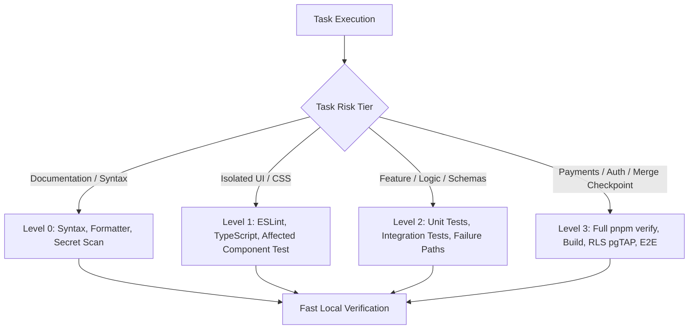

# 0010. Development Efficiency & Risk-Based Testing Protocol

**Status:** Accepted  
**Date:** 4 November 2026  
**Deciders:** Refat (Owner), Engineering Agent  
**Extends:** ADR 0006 (Testing Pyramid and Quality Gates)  
**Citations:** Supervisor Scope & Efficiency Directives; SRS NFR-MNT-01; AGENTS.md Rule R11  

---

## Context

During early project development, task iterations experienced significant turnaround overhead (such as 1 hour and 19 minutes on task P1-T2). Root-cause analysis revealed that this overhead was caused by:
1. Executing the entire end-to-end verification pipeline (including full `next build` compilation and test suites) for trivial documentation and configuration edits.
2. Repetitive, exhaustive file scans across the repository to rediscover information already located in documented paths.
3. Speculative execution and repeated command re-runs without root-cause diagnosis.
4. Parsing raw binary PDF streams to re-extract requirements that were already codified in Markdown files.

A disciplined, risk-based verification protocol is required to maximize development velocity while maintaining uncompromising security, financial integrity, and test coverage.

---

## Decision

### 1. Four-Tier Risk-Based Testing Protocol
Tasks are classified into four risk tiers. Each tier mandates specific verifications while explicitly prohibiting unnecessary steps during routine development loops:

| Tier | Category | Required Verifications | What Is Explicitly Prohibited |
| :--- | :--- | :--- | :--- |
| **Level 0** | Documentation, Markdown, non-code configurations (`.prettierrc`, `.gitignore`). | 1. Targeted file review. 2. Syntax / JSON formatting check. 3. Secret scan (`gitleaks`). | **NO** `next build`. **NO** Vitest suite. **NO** Playwright E2E. |
| **Level 1** | Pure UI components, layout styling, static JSON content edits. | 1. `pnpm lint` on modified files. 2. `pnpm typecheck` (`tsc --noEmit`). 3. Affected component test (`vitest run <file>`). | **NO** `next build`. **NO** full integration suite. |
| **Level 2** | Feature logic, Server Actions, Zod schemas, API route handlers, CSV exports. | 1. Relevant unit & integration tests. 2. Failure-path / edge-case tests. 3. `pnpm typecheck` & `pnpm lint`. | **NO** production build during routine intermediate iterations. |
| **Level 3** | bKash payments, authentication, RLS SQL migrations, branch completion before PR merge. | 1. Complete `pnpm verify` (`tsc`, `eslint`, `prettier`, `vitest`, `next build`). 2. pgTAP RLS tests. 3. Security review workflow. | **Never skip or loosen an assertion.** |

### 2. Context Loading Guidelines
* Read `AGENTS.md` and `docs/STATE.md` once at the beginning of a task.
* Read affected task files and relevant SRS requirements directly by path.
* Do not scan entire directory trees or recursively grep the workspace when specific file paths are established in documentation.

### 3. Absolute Prohibition on Binary PDF Extraction
* Never execute scripts or command-line tools to extract or parse binary PDF streams (`docs/source/*.pdf`).
* The plain-text markdown specifications ([`docs/SRS.md`](docs/SRS.md), [`docs/SCOPE-REVISION-V1.md`](docs/SCOPE-REVISION-V1.md), [`docs/architecture.md`](docs/architecture.md)) are the sole textual authorities.

### 4. Two-Attempt Diagnostic Limit
* When a command, compilation, or test fails, the agent must inspect the root cause before attempting a correction.
* If the identical issue persists after **two informed attempts**, the agent must halt execution, summarize the findings, and report the blocker rather than thrashing in repeated build/test loops.

---

## Consequences

* Drastically reduces task execution latency for routine changes.
* Eliminates compiler thrashing and memory exhaustion from repeated `next build` invocations on Windows.
* Preserves 100% of required CI and security gates at Level 3 checkpoints and PR merge gates.
* Ensures transparent, reproducible task verification.

